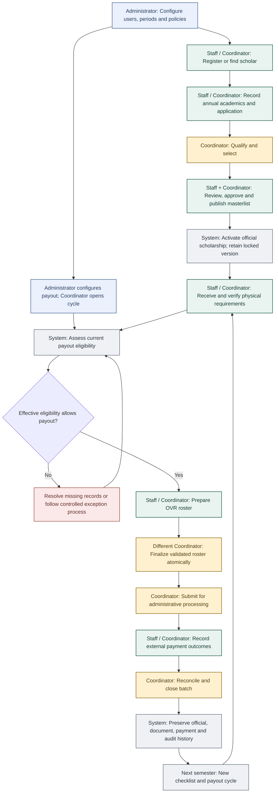
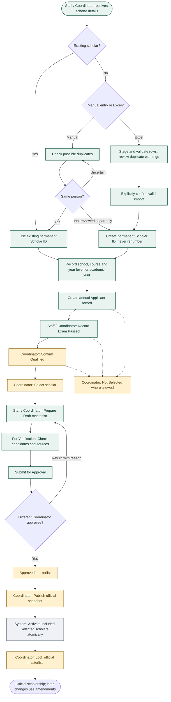
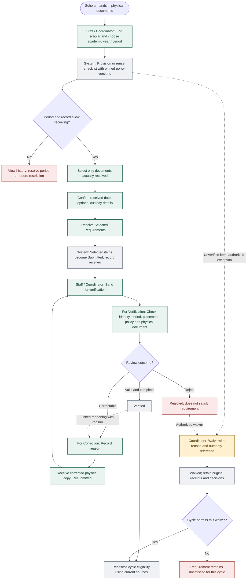
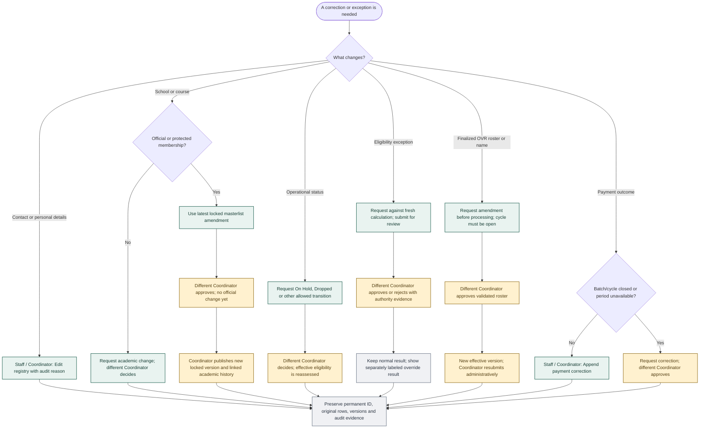
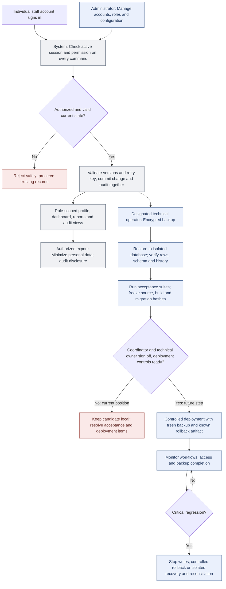

# LDSS full-process flowcharts

Based on the implemented v0.37.0 workflows. Prepared 2026-10-05.

These charts describe the implemented local system. F36 human acceptance and production launch remain pending.

**Roles:** Green = Staff / Coordinator operations; gold = Coordinator decisions; blue = technical administration; gray = system / records; red = blocked or unresolved work. Labels also state the actor; color is not required to understand the flow.

**Scope:** Internal staff only. Scholars submit physical documents; they do not log in. Requirements, qualification, operational status and payment eligibility are separate records. Receipt does not mean verification; selection does not mean activation; finalization does not mean payment.

## Full scholarship process

Start here. Each detailed chart below expands one part of this process.

## Registration to official scholarship

An exam pass or selection alone does not activate a scholar or make them payout eligible.

## Receive, verify and correct requirements

Navigate: Scholar registry > Open profile > Receive requirements. Documents remain physical; no student login or document upload.

## Eligibility, OVR and payment outcomes

OVR is the payout batch/roster. This application records disbursement outcomes; it does not transfer money.

```mermaid
flowchart TD
  setup["Administrator: Configure cycle, dates and required policy versions"] --> open["Coordinator: Open payout cycle"]
  open --> calculate["Staff / Coordinator: Request fresh eligibility calculation"]
  calculate --> normal["System: Check official membership, Active status, academics and required documents"]
  normal --> effective["Apply current approved override, if any; preserve normal result"]
  effective --> eligible{"Eligible with fresh sources?"}
  eligible -->|"No"| blocked["Show reasons; correct records or use reviewed override process"]
  blocked --> calculate
  eligible -->|"Yes"| roster["Staff / Coordinator: Add to Draft OVR; prevent duplicate cycle membership"]
  roster --> submit["Staff / Coordinator: Submit roster for review"]
  submit --> review{"Different Coordinator approves fresh full-roster validation?"}
  review -->|"Return to Draft"| roster
  review -->|"Yes"| finalize["System: Finalize every entry and snapshot atomically"]
  finalize --> adminSubmit["Coordinator: Record administrative submission"]
  adminSubmit --> process["Staff / Coordinator: Record processing evidence"]
  process --> external["Disbursement handled outside LDSS"]
  external --> outcome["Record Paid with positive amount, or Not paid with reason and zero"]
  outcome --> complete{"All members have outcomes and totals reconcile?"}
  complete -->|"No"| outcome
  complete -->|"Yes"| close["Coordinator: Close batch; freeze closure totals"]
  close --> cycleClose["Coordinator: Close cycle when its batches are complete"]
  cycleClose --> retain(["Preserve history; next semester uses new records"])
  class setup admin
  class open,adminSubmit,close,cycleClose coordinator
  class calculate,roster,submit,process,outcome operator
  class normal,effective,finalize,retain system
  class blocked exception
  classDef operator fill:#e9f3f0,stroke:#276657,color:#163d34,stroke-width:1.5px
  classDef coordinator fill:#fff1cf,stroke:#94701e,color:#533f12,stroke-width:1.5px
  classDef admin fill:#eaf0fc,stroke:#526f9a,color:#263b60,stroke-width:1.5px
  classDef system fill:#f0f1f4,stroke:#707b8a,color:#28323f,stroke-width:1.5px
  classDef exception fill:#fae9e8,stroke:#a75750,color:#632b27,stroke-width:1.5px
```

## Corrections, amendments and exceptions

A different Coordinator means a different authenticated individual from the requester or submitter; not a second role on the same account.

## Oversight, security and release

These controls apply throughout the scholarship process. F36 technical tests passed; human sign-off and production readiness remain pending.

## Reading notes

- Registration is once per person. Each academic year adds its own academics and scholarship record; a new semester adds a new checklist/cycle without resetting older paid history.

- Excel stages and validates data before explicit confirmation; it does not silently overwrite existing people. Resolve duplicate rows before confirming an import.

- Qualification requires a complete same-year academic record. Not Selected ends that annual qualification path. Official publication activates included Selected scholars.

- Normal eligibility requires current authoritative records and satisfying document statuses. Waivers only count where cycle policy allows them. Normal ineligibility includes Dropped status. An approved eligibility override is a separate, audited exception, not an alteration to the normal calculation. Source changes require recalculation/review.

- Requirement verification is permitted to both Staff and Coordinator. It does not require a different person from the receiver. Approval workflows requiring an independent Coordinator are explicitly labeled.

- Unverified requirement states may receive an authorized waiver; Verified/Waived cannot simply be replaced by a waiver. Rejected documents do not use ordinary resubmission: the shown resubmission path starts from For Correction.

- Masterlists can be returned to Draft at permitted pre-publication states. Published/Locked originals are never reopened; amendments create new versions.

- OVR draft admission and finalization recheck current sources, duplicates and pending changes. Failed finalization rolls back the whole operation. A pending OVR amendment pauses administrative processing; amendments are unavailable after processing begins.

- A rejected/cancelled change request has no effect on the authoritative record. Reapproval never erases the original evidence. Terminal status corrections use linked correction history rather than deleting status events.

- Closed-batch corrections preserve original closure totals and show corrected effective totals separately. Closing a batch does not itself close the whole payout cycle.

- Routine receiving uses the simplified screen. Additional custody details are optional; decision reasons/references remain required where the workflow calls for them.

## Implementation references

- [Implementation plan](../LDSS_Codex_Function_by_Function_Implementation_Plan.md)

- [Official publication and activation](F11-delivery.md), [masterlist amendments](F12-delivery.md)

- [Verification](F16-delivery.md), [waivers](F17-delivery.md), [overrides](F20-delivery.md)

- [OVR processing](F23-delivery.md), [OVR amendments](F24-delivery.md), [payment corrections](F25-delivery.md)

- [F36 acceptance checklist](F36-acceptance-checklist.md), [release and rollback](F36-release-runbook.md)
