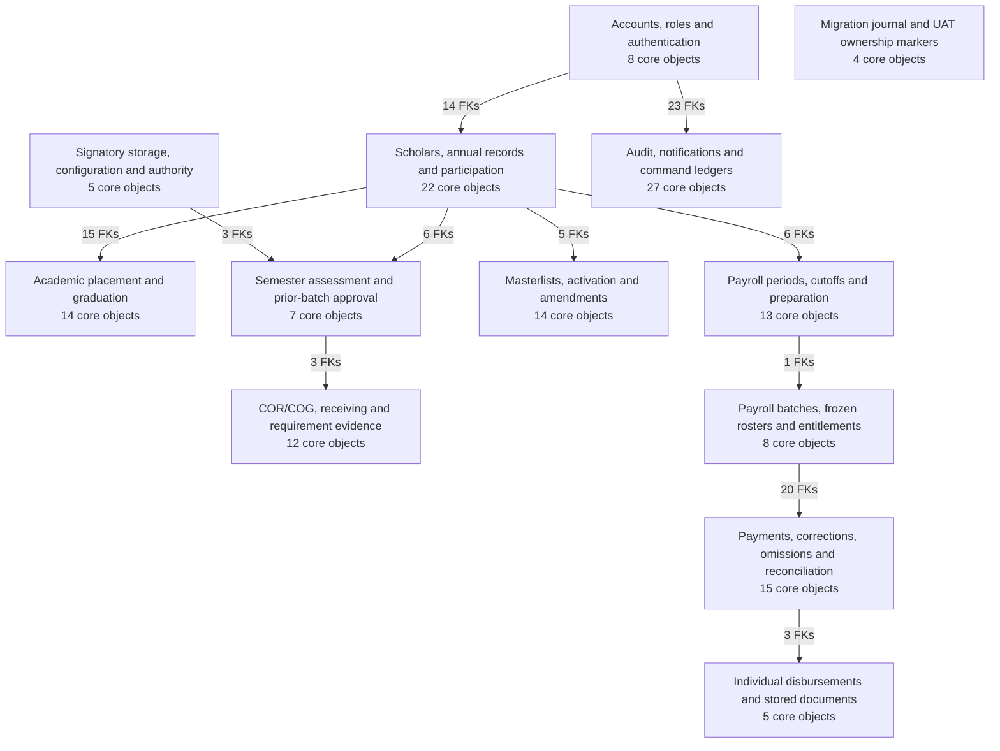

# LDSS system overview

This is a physical schema map, not a permission, payment-authority or workflow-transition diagram.

[Overview SVG](exports/LDSS_SYSTEM_OVERVIEW.svg) · [Mermaid source](LDSS_SYSTEM_OVERVIEW.mmd)

## Domain guide

| Module | Core objects | Context parents | FK edges | Source / SVG |
|---|---:|---:|---:|---|
| Accounts, roles and authentication | 8 | 0 | 6 | [Source](modules/01-authentication.mmd) / [SVG](exports/01-authentication.svg) |
| Scholars, annual records and participation | 22 | 4 | 49 | [Source](modules/02-scholars.mmd) / [SVG](exports/02-scholars.svg) |
| Academic placement and graduation | 14 | 7 | 49 | [Source](modules/03-academic.mmd) / [SVG](exports/03-academic.svg) |
| COR/COG, receiving and requirement evidence | 12 | 7 | 36 | [Source](modules/04-documents.mmd) / [SVG](exports/04-documents.svg) |
| Semester assessment and prior-batch approval | 7 | 12 | 25 | [Source](modules/05-semester-approval.mmd) / [SVG](exports/05-semester-approval.svg) |
| Masterlists, activation and amendments | 14 | 7 | 36 | [Source](modules/06-masterlists.mmd) / [SVG](exports/06-masterlists.svg) |
| Payroll periods, cutoffs and preparation | 13 | 7 | 34 | [Source](modules/07-payroll-windows.mmd) / [SVG](exports/07-payroll-windows.svg) |
| Payroll batches, frozen rosters and entitlements | 8 | 6 | 21 | [Source](modules/08-payroll-entitlements.mmd) / [SVG](exports/08-payroll-entitlements.svg) |
| Payments, corrections, omissions and reconciliation | 15 | 14 | 67 | [Source](modules/09-payments.mmd) / [SVG](exports/09-payments.svg) |
| Individual disbursements and stored documents | 5 | 6 | 17 | [Source](modules/10-individual-documents.mmd) / [SVG](exports/10-individual-documents.svg) |
| Signatory storage, configuration and authority | 5 | 2 | 6 | [Source](modules/11-configuration.mmd) / [SVG](exports/11-configuration.svg) |
| Audit, notifications and command ledgers | 27 | 11 | 35 | [Source](modules/12-audit-commands.mmd) / [SVG](exports/12-audit-commands.svg) |
| Migration journal and UAT ownership markers | 4 | 0 | 0 | [Source](modules/13-environment.mmd) / [SVG](exports/13-environment.svg) |

Each constraint appears in the module owning its child table; referenced parent tables are repeated for context. Shared parents do not imply duplicate storage.

There is **no persistent backup job/history schema** in either inspected target. Module 13 contains the actual migration journal and UAT ownership markers only. Signatories and configurable document capacities occupy reserved system_settings rows; stored generated Individual Payment documents use the real document-version/content tables. No signatory, template or backup-job table was invented.

Published Masterlist membership, eligibility, entitlement reservation, Payroll finalization/submission/processing and recorded payment outcomes remain separate entity groups. ERD links do not equate these business states.
