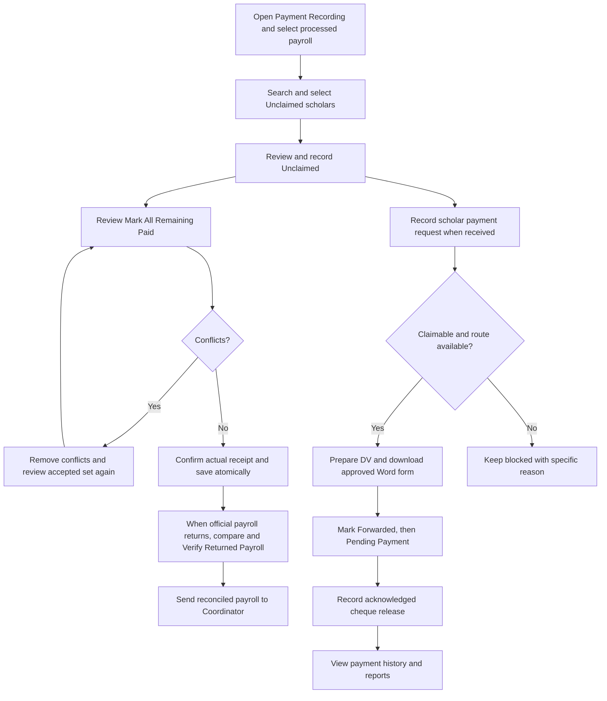
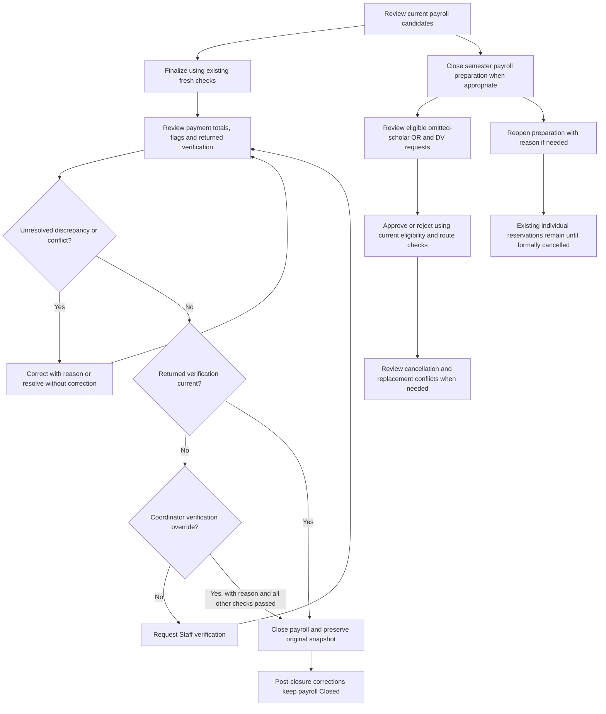

# Payroll and payment processing implementation plan

Date: 23 October 2026. Status: **P01–P09 accepted for local development by the P10 authorization. P10 local technical verification is complete and awaiting explicit user acceptance. P06 draft form layouts still require Scholarship Office approval before official use. No operational activation or LAN/production deployment is authorized**.

Revision: documentation-only correction following the office's review. P01 is now a **reuse-first, no-DDL foundation**; new operational tables are deferred to the phase that demonstrates their need. Routine Staff authority and the two distinct unpaid processing routes below are agreed requirements, not open questions.

## 1. Scope and evidence

Enhance the existing LDSS application, using its React/TypeScript interface, Fastify services, MariaDB records, authorization, command journals and audits. Keep one entitlement model and one authoritative payment history. Do not rebuild the application, invent payroll batches for individual payments, replace the database or introduce a second payment engine.

This plan follows the user-supplied **Complete Payroll & Payment Processing Enhancement** request. P01–P10 below are new payment-enhancement phases, independent of older F00–F36 and workflow phase numbers. The subsequent **P10 Full Integration, UAT & Final Technical Verification** request accepts P01–P09 for local development and authorizes P10 local verification/narrow stabilization only. It does not authorize operational activation, the proposed P11 audit/questionnaire, production-data changes or LAN deployment. The supplied `DV.pub` and `OBR.pub` samples remain visual/field-mapping references, not approval of individual-payment forms.

### Mandatory development and acceptance standards — P01–P10

The office's P01 authorization makes these requirements permanent for every applicable phase. They do not amend eligibility, claimability, Staff/Coordinator authority or financial rules.

| Standard | Required implementation and phase evidence |
|---|---|
| Simple, direct, accessible UI | From P02, deliver usable controls in the existing design system: readable tables, keyboard/focus support, consistent responsive layout and actionable validation. P09 refines an already usable interface. P01 introduces no screen and must preserve existing screen behavior |
| Minimal clicks and typing | Demonstrate routine steps: Select Payroll → Find ten Unclaimed → Mark Unclaimed → Mark All Remaining Paid → Confirm. No per-scholar forms for the other 825. Unclaimed: Find → Request → Prepare DV → acknowledged cheque payment. Omitted: Find → Record Omission → eligible later payroll or approved OR + DV. Reconciliation: Review → Verify Returned Payroll → Coordinator closes |
| Familiar terminology | Use Search Scholar, Mark Paid, Mark Unclaimed, Mark All Remaining Paid, Record Payment Request, Prepare DV, Prepare OR + DV, Download Word, Mark as Forwarded, Report Discrepancy, Verify Returned Payroll and Close Payroll. Keep state-machine names, hashes, transactions and cache/idempotency keys internal |
| Known fields automatic | Populate identity, academic year/semester, approved amount, batch, authenticated actor and appropriate timestamps from authoritative sources. Optional inputs belong under Additional Details; reasons are required for corrections, cancellation, overrides and exceptions, not redundant routine forms |
| Preserve R01–R07 | Retain optimized/indexed SQL, server pagination, bounded preload/chunking, request-scoped reuse, safe invalidation, lightweight responses, lazy loading, request deduplication and scoped UI refreshes. No module rewrite without demonstrated need and before/after evidence |
| Efficient bounded reads | Payment screens/search must not load Registry/full cohorts, rebuild payroll drafts or repeatedly compute eligibility. Keep selection across pages without downloading every row. Individual queues, Word rendering and exports load only related, bounded sources; bulk writes use one protected backend operation rather than hundreds of HTTP calls |
| Cache correctness | Reuse current caching/invalidation; introduce no parallel cache framework. Consequential writes recheck current permission, entitlement, effective payments and allocation/route conflicts under existing transactions/locks. Cached financial projections cannot authorize payment |
| Measure regressions | Before changing sensitive modules, capture available baseline behavior/query counts/time/memory/cache observations; repeat equivalent checks afterward. Report actual measurements or explicitly explain non-applicability/unavailable checks. Significant unexplained regressions block acceptance; retain R07's unresolved peak-RSS limitation |
| Financial integrity | Preserve one canonical payment source, entitlement uniqueness, duplicate prevention, RBAC, command retries, append-only corrections/audits, transaction/lock order, frozen payroll/closure and historical evidence. Prepared/forwarded/approved documents or an issued cheque alone are not Paid; acknowledged actual release is required |
| Every phase report | Include affected services/queries, preserved optimizations, before/after measurements where applicable, cache freshness/invalidation, memory, index/query-plan changes, tests and remaining risks. User-facing phases also assess steps/clicks, typing, labels, search, loading/errors, keyboard use, responsive behavior and workflow efficiency |

For P01 specifically: no schema/migration/seed/grant changes, no production-data writes, no new active financial API/UI and no LAN deployment. Use existing disposable-test conventions. Stop if implementation requires a database change; explain it for separate approval instead of applying it. Test reports distinguish newly executed validation from historical baselines and disclose failed/unrun checks. After P01, stop for explicit P02 approval.

### Provenance register

| Basis | Meaning in this plan |
|---|---|
| Office request | Procedures expressly requested in the supplied specification: bulk outcomes, same-recorder returned-payroll verification, Coordinator closure/corrections, DV-only for Unclaimed, authorized OR + DV for omitted scholars, acknowledged cheque release and representative-document checks. These are requested office procedures, not independently verified law. |
| Current code | Behavior observed in the inspected repository. A restriction in code is not automatically an ordinance provision. |
| Proposed design | Engineering choices below, subject to phase approval and validation. Proposed tables, permission names and endpoints do not exist yet. |
| Screenshot references | The supplied OR and DV screenshots are visual/field-mapping references only. Original editable Word templates are currently unavailable. The samples are not approved individual-scholarship forms or proof of exact formatting specifications; sample names, amounts, certifications and accounting details are not current transaction authority. |
| Ordinance authority | No controlling ordinance/amendment or approved individual-payment OR/DV template was supplied for this planning pass. The ordinance wording printed by the existing payroll renderer, screenshots and references in older design documents do not independently verify legal requirements. |

The existing [policy specification](../LDSS_WORKFLOW_PHASE03_SPECIFICATION.md) itself distinguishes office instructions, a presentation, workflow material and engineering design. Preserve that distinction. Do not reuse the earlier Rannel Faraon semester-document instruction reference as authority for unrelated financial rules or form approval.

### Repository baseline

- Git base: `89cba417442219f3839e59766e19b62fa744b944`, with substantial existing uncommitted work. A commit hash alone does not describe this baseline.
- Before writing this plan, all **577 source inputs, 211 compiled artifacts and 55 migration hashes** matched the accepted R07 manifest. See [accepted gate](../../output/qa-r07-cohort-20261021/uat-r1/F36-report.json) and [R07 report](../performance/R07_OPTIMIZATION_REPORT.md).
- That prior gate passed 57 suites and 485 unit tests. These are baseline results, **not newly executed enhancement tests**.
- R01–R07 improvements are present. R07 retained heap stabilized, but its peak-memory target was not fully met: sampled maximum RSS increased approximately 402 to 449 MiB. Preserve the improvements without claiming this limitation is resolved.
- Inspection covered application/service registration, authentication/CSRF, authorization/grants, OVR and payment services, migrations, reports/exports, Word rendering, UI components and relevant test harnesses. No database connection, production inspection, payment command or migration was needed for this plan.

## 2. Existing functionality inventory

| Area | Confirmed implementation | Reuse or limitation |
|---|---|---|
| Authentication and authorization | [auth routes](../../server/auth/routes.ts), [authorization service](../../server/authorization/service.ts), [permission catalog](../../server/authorization/policy.ts) | Sessions, origin/JSON/CSRF checks, transaction-scoped permissions and role revocation checks. Pure System Administrator does not receive operational payment authority. |
| Financial serialization | `AuthorizationService.withPermission()` acquires `configuration_guard` before current authorization and business reads | Retain the guard, transaction boundaries and lock ordering; do not remove it as a performance shortcut. |
| Numbered payroll creation | [submission service](../../server/payouts/submission-service.ts) creates numbered drafts through Coordinator window setup | Ordinary `OvrService.create` cannot create a managed batch. Do not offer Staff an unrestricted Create Batch endpoint. |
| Candidates and finalization | [OVR service](../../server/ovr/service.ts), [managed payroll](../../server/ovr/managed-payroll.ts), [rules](../../server/ovr/rules.ts) | Automatic candidates, review submission, fresh validation, source fingerprints, frozen forms and allocations. Managed membership cannot be manually added/removed; Coordinator deferral/restore controls it. |
| Semester entitlement | [foundation migration](../../db/migrations/20261006010000_f36_workflow_foundation.sql) | Unique scholar + semester + benefit; current degree stipend is 500000 centavos/PHP by CHECK. Reuse this identity, including annual-record aliases. |
| Initial payment outcomes | [processing service](../../server/ovr/processing-service.ts) | One outcome per command, `paid`/`not_paid`, fixed amount, separate actual date and recording time, duplicate checks, receipt confirmation and immutable event history. |
| Processing stages | `finalized → submitted → processed → closed` | Ordinary payment recording requires `processed`; Coordinator submits, Staff/Coordinator processes. Preserve this lifecycle unless separately approved. |
| Treasury evidence | [Treasury service](../../server/ovr/treasury-service.ts), [Treasury state](../../server/ovr/treasury-state.ts) | Paid recording requires current batch evidence and its revision. Existing evidence corrections require Coordinator authority. This is not the requested aggregate returned-payroll verification. |
| Release safeguards | [managed release](../../server/ovr/managed-release.ts) | Current academic/document/standing restrictions, holds, frozen allocation membership and original release link. Approval or printing is not payment. |
| Corrections | [correction service](../../server/ovr/payment-correction-service.ts), [effective payment projection](../../server/ovr/payment-correction-state.ts) | Append-only before/proposed/after history; original rows remain intact. Managed corrections currently require request/approval, including date changes. |
| Reconciliation and closure | [processing state](../../server/ovr/processing-state.ts), `OvrBatch.closure` | Current totals and recorded closure totals already exist. Closure does not store the new complete row-level closure report. |
| Cycle closure | [payout closure](../../server/payouts/closure.ts) | Blocks unfinished batches and pending corrections. This must remain distinct from closing payroll preparation. |
| Unclaimed and reprocessing | [reprocessing service](../../server/ovr/reprocessing.ts), [reprocessing migration](../../db/migrations/20261009010000_f36_unclaimed_reprocessing.sql) | `did_not_claim`, `withheld`, `review`; closed Unclaimed attempts queue for a later same-semester payroll. No DV queue/request/transaction implementation was found. |
| Claimability | `claimDeadline()`, `requireClaimOpen()`, [deadline helper](../../server/ovr/claim-deadline.ts) | Current rule uses semester end, inclusive in Philippine time; missing end blocks release. No timely scholar-request preservation mechanism exists. |
| Historical receipt encoding | `TreasuryService.historical()` | After expiry, ordinary release is blocked; documentary proof of earlier receipt requires controlled Coordinator approval. Unknown exact historical date can remain null. |
| Legacy containment | [legacy boundary](../../server/ovr/legacy-boundary.ts), [conversion service](../../server/ovr/legacy-conversion.ts) | Unnumbered payrolls remain read-only except established controlled historical workflows. Never manufacture an entitlement from an unmapped legacy attempt. |
| Fast payroll reads | [detail reads](../../server/ovr/detail-reads.ts), [detail models](../../server/ovr/detail-model.ts) | Lightweight summary, paged candidates/roster/history/payments and lazy sections. Processing section still loads extensive release/compliance evidence; do not use it to open the new Payment Recording screen. |
| Payment UI | [processing panel](../../src/OvrProcessingPanel.tsx), [Treasury UI](../../src/TreasuryReconciliation.tsx), [corrections UI](../../src/PaymentCorrections.tsx), [reprocessing UI](../../src/PayrollReprocessing.tsx) | Existing individual entry and controlled actions; Treasury search filters a loaded roster and chooses one scholar. No cross-page bulk selection or Mark All Remaining Paid. |
| Payroll Word | [Word renderer](../../server/ovr/payroll-word.ts), [form/layout](../../server/ovr/payroll-form.ts) | Existing editable payroll DOCX/HTML, fixed 20 scholars/page for v2 and preserved frozen v1 rendering. This is not an OR/DV template. |
| Reports and exports | [operational reports](../../server/reports/service.ts), [report routes](../../server/reports/routes.ts), [Excel export](../../server/exports/service.ts) | Paged operational payment reports include current corrections and attempts. Excel infrastructure/auditing exists for registry/audit exports. No dedicated reconciliation XLSX/PDF export or server PDF renderer was found. |
| Tests and deployment safety | [UAT gate](../../scripts/test-uat.mjs), [migration/grant helpers](../../scripts/migration-lib.mjs) | Disposable financial/concurrency fixtures, migration checksums, restricted grants, backups/restores and source fingerprints. Reuse these controls. |

The revision also inspected the existing authority/policy/scope tables, `ovr_batch_events`, command journals, entitlement events, allocation constraints, submission-window rules and requirement-timing rules. Findings relevant to the smaller foundation and later-batch integration:

- `workflow_authority_versions` and `workflow_policy_versions` already provide versioned authority, references, dates and rules. Payment policy metadata does not need another policy table. Financial policy records must have a distinct purpose/code and must not be inserted as receiving cohorts in `workflow_scope_versions`.
- `ovr_batch_events` already provides unique batch revisions and immutable snapshots. Effective payment/correction/classification sources can supply a financial hash; another persistent head is not yet justified.
- `managedCandidates()` evaluates the year's scholars, not just manually listed draft members. `semesterSources()` rejects other allocations and protected historical payroll membership; timing is evaluated against the destination batch cutoff. A receipt before a later window opens is not automatically late: existing timing classification compares receipt/encoding against its cutoff, without requiring a new receipt after opening.
- Historical payout setup currently pins approval to its original batch/import. A later destination cannot simply reuse that root batch ID or silently inherit its timing acceptance. Section 6 defines the explicit integration needed in P05.

## 3. Requirements-to-code gap matrix

Numbers refer to the numbered requirements in the supplied request.

| Requirements | Current gap | Planned treatment | Phase |
|---|---|---|---|
| 3–6 | Financial controls exist but are spread across disclosures and forms | Four Payroll tabs; automatic known fields; optional details; retain specialized tools and deep links | P02, P09 |
| 7 | No dedicated lightweight payment workspace | Summary/counts plus paginated frozen-roster search, independent of draft generation | P02 |
| 8–10 | One payment per command; no persistent selection or bulk conflict preview | Batch-scoped selection, authoritative preview, explicit accepted set, atomic multi-row commit and safe retries | P02 |
| 9 | No Mark All Remaining Paid | Server snapshots records with no outcome; preview counts/amounts; never infer payment without confirmation | P02 |
| 11 | Fixed amount exists; dates may be null and managed corrections need approval | Server-derived amount; new ordinary Paid requires actual date; agreed Staff date-only correction with reason; extra closed/expired-period restrictions isolated; historical unknowns preserved | P01–P03 |
| 12–13 | Paid currently depends on returned Treasury evidence; no version-bound aggregate verification | Separate actual-release confirmation from later returned-payroll verification; retain old evidence | P02–P03 |
| 14–16 | Closure exists, but accepts all recorded not-paid classifications and lacks new verification/override/full snapshot | Versioned completion rule, verification/override, conflict/discrepancy gates, immutable full closure snapshot and post-closure effective projection | P03 |
| 17–18 | Correction requests exist; general discrepancy tracking and active DV cancellation do not | Append-only discrepancy cases, Coordinator resolution and route synchronization | P03–P04, P07 |
| 19–20 | Unclaimed queues only at closure for another payroll; no request or DV | Immediate derived DV queue where claimable, real-time request capture, one active DV, no extra routine approval | P04 |
| 21 | Managed batches prohibit manual adds; historical setup can be root-batch-specific | Section 6 destination-origin linkage, fresh automatic candidate validation and existing Coordinator finalization; no direct entry insert or source-rule override | P05 |
| 22–23 | Cycle closure is too broad and blocks financial work; no preparation-only switch | Separate semester preparation close/reopen and authorized OR + DV request; keep cycle/period locking intact | P05 |
| 24–28 | No individual OR/DV model, approved editable templates, replacement lineage or conflict workflow; screenshot references are available | Shared contracts in P01; operational persistence in later phases; P06 editable draft DOCX recreation and office review, with replaceable template assets | P01 contracts; P04–P07 |
| 29–31 | No individual cheque or representative attestation route | Same canonical Paid write; single/bulk scholar acknowledgments; representative checks only on individual recording, without personal data | P07 |
| 32–35 | Current report differs from a closure-time report; no required export sections | Provisional/original/updated reports, Paid/Unclaimed/Pending sections, audited XLSX/PDF | P03, P08 |
| 36–37 | Guards exist but only cover payroll-based attempts | Extend every existing claim/route reader and consequential writer to include individual attempts; keep reads bounded and fresh writes authoritative | All |
| 38–40 | New workflows have no implementation coverage | Phase-specific negative/concurrency/migration/performance tests, then complete integration UAT | Each phase, P10 |

## 4. Conflicts that must be resolved explicitly

| Observed constraint or rule | Consequence for this request | Proposed handling |
|---|---|---|
| Paid requires `treasuryEvidenceRevision`; actual date cannot follow office receipt of signed evidence | Recording before official payroll return is currently rejected | New approved workflow permits actual acknowledged release while processed, then a distinct returned-payroll check. Do not silently remove old checks for existing clients/legacy records. |
| Ordinary actual date cannot precede prior processing action | A genuine earlier cheque release encoded later may be rejected | Implement the agreed distinction between actual date and encoding/processing time for ordinary open periods. For closed/expired periods, preserve existing documentary/Coordinator restrictions until the narrow boundary in Q2 is resolved; never treat date editing as a new release. |
| All managed corrections use request/approve | Agreed Staff date-only correction and direct Coordinator outcome correction are unavailable | Staff can correct the actual date with a reason; this is settled authority. Introduce a narrow date-only command, not a fresh request for ordinary Staff approval. Only additional closed/expired-period restrictions remain unresolved. Keep outcome changes Coordinator-only and retain existing pending requests. |
| `not_paid` includes withheld/review as well as did-not-claim | Mapping every not-paid row to Unclaimed would discard restrictions | Only `did_not_claim` maps to Unclaimed. Show unresolved withheld/review separately; never silently classify them. |
| Current `reconciliation.complete` accepts all explicit outcomes | Requested completion/normal closure requires Paid or Unclaimed, not unresolved withheld/review | Add a versioned financial completion projection. Preserve old closed snapshots and distinguish older completion semantics. |
| One payment row per batch revision is UNIQUE | Inserting 825 payments at one revision would fail or require weakening a constraint | Retain unique revisions: one compact compatible event/revision per outcome, within one parent operation/transaction. Prototype storage/reader compatibility before P02 acceptance. |
| Payment rows require a frozen payroll FK | Individual payments cannot be inserted safely today | P05 extends unpaid transaction source identity only. Extend the canonical payment table with a constrained individual source when P07 settlement is separately authorized; do not create fake payrolls or an unrelated paid ledger. |
| `entitlement_release_links` preserves the first release | Deleting it to reuse a stipend would destroy evidence | Preserve it; append attempt/correction evidence and use one shared effective-claim resolver across all routes. |
| Queue creation occurs on batch closure or a closed-period correction | Requested DV visibility begins when Unclaimed is recorded | Derive the new queue immediately, without changing the original outcome or creating a DV automatically. Existing payroll retries need explicit route resolution. |
| Current claim deadline is semester end, not submission cutoff or payout target | Financial/Releasing Office claiming instructions may differ; the controlling cutoff and timely-request effect have not been supplied | Do not implement a three-working-day counter, holiday calendar or new entitlement extension. Preserve the current technical restriction while the office resolves Q1. A request timestamp alone does not establish collection rights. |
| Current closed batch stores closure reconciliation, not every closure-time row | `originalPayments=true` is not the requested original closure report when corrections preceded closure | Store a new complete immutable closure snapshot. Reconstruct older closures only where history proves the state; otherwise report unavailable. |
| Preparation closure does not exist | Closing the payout cycle would also block payments/reprocessing | Add a preparation-only control; never implement it by closing/locking the cycle or academic period. |
| Earlier documentation describes separate-person finalization | Inspected OVR handler primarily enforces role/state/revision/source checks; inspected self-test checks Staff denial, not a Coordinator actor-inequality rule | Preserve actual current finalization authorization and approval separation. This enhancement does not request a new distinct-person rule, so documentation drift is a regression/documentation finding, not a launch-policy question. |

## 5. Shared architecture and financial invariants

### One source of payment truth

Retain `semester_entitlements` as the benefit identity and extend `payment_records` plus its correction history as the canonical record of actual payment attempts. An individual transaction prepares documents and reserves a route; it is not itself a paid record. No new `individual_paid` ledger may independently decide whether a stipend has been paid.

Use existing eligibility/compliance, official membership, Course pending provenance, standing, holds, waivers/overrides, deferrals and legacy conversion services. Extract transaction-aware primitives where necessary; do not duplicate their calculations. The same source resolver must power Registry, Dashboard, payroll, individual queues and reports.

Mandatory invariants:

1. One degree entitlement per permanent scholar/semester/benefit. Annual-record aliases cannot create another claim.
2. The approved amount remains the existing entitlement amount; current degree constraints are PHP 5,000. Staff never supplies an authoritative amount. No partial ordinary payments.
3. At most one active financial route per entitlement. Historical allocations, attempts and cancelled documents remain preserved.
4. An effective Paid claim, unresolved payment correction, pending historical receipt or route conflict blocks another payment everywhere.
5. A document, forwarded status, approval, generated form or reported release date never means Paid. Actual acknowledged cheque release must be confirmed.
6. No receipt, verification, academic finding, historical course, masterlist membership or payment is manufactured by this enhancement.
7. Corrections append evidence. Original payment rows, frozen payrolls and closure snapshots remain unchanged.
8. Dates are honest: actual payment date is distinct from system recording time; request/forwarding/verification times are system-generated. Existing unknown historical payment dates remain unknown.

### P01 table review: reuse before adding schema

**Recommended P01 database delta: zero new tables, zero ALTER statements, zero seeds, zero backfill and zero runtime-grant changes.** P01 defines types, compatibility adapters, guarded transaction primitives and tests; it exposes no new financial action. An inactive foundation does not need speculative operational persistence. A failure to prove reuse is reported for review, not used to add an unapproved table.

This review covers every table/header/event family proposed for P01 in the previous revision:

| Previous proposal | Existing structure examined; invariant it can or cannot enforce | Revised decision |
|---|---|---|
| `payment_workflow_versions` | `workflow_authority_versions` + `workflow_policy_versions` already pin authority, references, rules and versions. A versioned `ovr_batch_events.snapshot` can pin the reviewed payment policy to a batch later. Reuse is adequate for provenance; it does not replace payment/route constraints | Remove the new table. Define a payment-specific purpose/code and strict decoder; later opt-in uses an audited batch event. Do not overload academic receiving `workflow_scope_versions` or seed invented authority |
| `payroll_financial_heads` | Unique `(batch_id,revision)` in `ovr_batch_events`, plus effective corrections, unpaid classifications, historical receipts and frozen roster hashes, already identify current financial sources. A separate head would duplicate state and require every writer to synchronize it | Remove the table. P01 defines one deterministic financial basis from existing bounded reads. P03 verification pins that basis; use request-local reuse only. Add no persistent head without measured evidence and a separately reviewed consistency design |
| `individual_payment_transactions` | `payment_records` requires a frozen payroll; `payroll_reprocessing` requires an existing payment and frozen source. Neither can represent an omitted scholar's request, an unpaid individual document or cancellation/replacement lineage without inventing payroll/payment facts | Defer the typed header to P04, extended for omissions in P05. It is justified when those commands exist, not in P01. Preserve one canonical Paid ledger |
| Individual transaction events | `workflow_commands` stores exact retry results and `audit_logs` stores attribution, but neither provides the domain FK plus unique transaction revision needed for validated state transitions | Defer a typed append-only event relation with the P04 header. Reuse existing command and audit tables; do not create a second command journal or generic audit system |
| `entitlement_payment_routes` | `semester_entitlements` ensures one benefit; `payroll_allocations` reserves only a finalized payroll, and `entitlement_release_links` preserves the first release. None reserves a pending individual request against a competing payroll or replacement. Removing historical allocation links would be unsafe | Defer the minimal active-route relation to P04/P05, when multiple routes become operational. Before then preserve existing guard/claim/allocation constraints. Later key exclusivity by permanent scholar + semester + benefit, because omitted requests can precede entitlement creation; pin the matching entitlement FK when authorized |
| Route event table | Existing command results/audits can retain before/after owner, revision, reason and source links; a second event stream is not automatically necessary | No P01 table. In P04 first prove reuse of immutable command/audit evidence; propose a separate typed route-event relation only if required FK/revision invariants cannot be enforced otherwise |

Later-phase persistence remains a design obligation, not permission to create all tables now:

| Owning phase | Needed evidence and smallest-change approach |
|---|---|
| P02 | Reuse batch events, payment rows, correction history, policy records and existing journals. Seed only capabilities actually implemented in that phase. No persistent payment head by default |
| P03 | Returned verification, discrepancies and complete closure snapshot need durable typed evidence. First evaluate compatible extensions to existing batch/correction events and closure encoding; justify each new relation against FK, immutable-history and bounded-read needs before its migration |
| P04 | Individual header/events and, if needed for operational exclusivity, the active-route relation above. Scholar requests are events with server timestamps; DV queue is a read projection, not another ledger/table |
| P05 | Preparation state and omission-origin metadata should reuse versioned evidence where safe. An unapproved omitted request pins scholar/semester/benefit without fabricating an entitlement; Coordinator authorization creates/reuses the single valid entitlement. Extend canonical payment source linkage only when individual payment support requires it |
| P06 | Prototype/approved template status, versioned generation metadata and latest content require a storage/backup design. Recreate editable DOCX from the screenshots; reuse existing audits/journals and justify content storage. Original Word availability is not a prerequisite |
| P07 | Reuse P03 discrepancy evidence for payment conflicts; no duplicate conflict-case system |

For the deferred P07 canonical payment-source extension: existing payroll records retain paired batch/revision values and no individual source. An individual payment must have a valid approved individual transaction and matching entitlement, with no fabricated batch/revision. A CHECK requires exactly one valid source. Keep existing batch/scholar and batch/revision uniqueness; add the necessary individual uniqueness and composite identity FKs. An unapproved request cannot be a payment source. Test every reader, correction command, export and grant before activation. P05's explicit authorization excludes individual payment recording, so its unpaid-header extension does not alter `payment_records`.

Existing `workflow_commands` and `ovr_commands` remain command journals. Later runtime grants must be limited to commands actually implemented. Audits/events remain append-only; never disable FKs, relax existing payment uniqueness or edit applied migrations.

### Financial basis and later route activation

P01's financial-basis adapter must include initial payments, effective corrections, unpaid classifications, pending/approved historical receipts and frozen roster/amendment provenance. Omission of any contributing source is a failed acceptance test. Do not infer payment authority from a batch revision alone. P03 compares the full basis to invalidate returned verification after relevant changes; unrelated downloads do not invalidate it.

P01 creates no heads, reservations, authorizations or feature-activation rows. No GET writes. Before P04/P05 route activation, inventory allocations, effective payments, pending corrections/historical receipts and reprocessing assignments in an isolated rehearsal. Existing historical ownership remains authoritative even if a new route table is empty. Initialize unambiguous active owners only through a reviewed command; conflicts block activation for the affected entitlement.

For old payroll-reprocessing assignments, preserve frozen attempts and their compatibility processing; do not rewrite them as DV transactions. Unfinalized assignments must be explicitly withdrawn/reviewed before enabling a competing DV route. New Unclaimed cases in the new workflow are DV-only. This is a controlled compatibility disposition, not an unanswered request to choose the Unclaimed route again.

## 6. States and validation boundaries

### Payroll

Keep `draft → review → finalized → submitted → processed → closed`. Keep Coordinator return-to-draft and finalization checks. New Payment Recording normally operates only at `processed` on an authorized numbered payroll with frozen membership; this is the recommended interpretation of the request's appropriate financial stage.

Do not overload batch state with every new flag:

| Separate projection | Meaning |
|---|---|
| Recording incomplete | At least one frozen member has no outcome, or unresolved withheld/review classification remains |
| Recording complete | Every member has a valid Paid or Unclaimed outcome; Pending = 0, no unresolved classification |
| Returned payroll not verified / verified / re-verification required | Latest verification matches, or no longer matches, current outcome and roster basis |
| Discrepancies/conflicts | Independent unresolved cases; block closure/payment as appropriate |
| Closed | Immutable original closure remains; current corrections do not reopen it |

Before closure, a payment/date/classification or supported roster change invalidates current returned verification but preserves its event. Normal closure requires complete reconciled amounts/counts, no pending correction/discrepancy/conflict and current verification. Coordinator may override only verification with a reason, not missing outcomes, financial conflicts or eligibility safeguards. No new returned verification is accepted after closure.

### Individual payments and preparation

| Route/transition | Validation |
|---|---|
| Effective Unclaimed → visible DV queue | Root frozen membership, valid unpaid entitlement and current claimability; no automatic DV |
| Record Payment Request | Current actor/time; capture request even if it must remain blocked, without implying claimability |
| Request → DV-only transaction | Staff; no additional routine Coordinator approval, but claim/hold/source/route checks must pass |
| Omitted scholar → later numbered payroll | Preparation open; destination same semester, draft/window available; authoritative ordinary qualification and automatic membership still apply |
| Preparation closed → OR + DV request | Staff submits eligible omission/source batch; request reserves the permanent scholar/semester/benefit route without manufacturing an entitlement and prevents simultaneous payroll inclusion |
| OR + DV request → approved/rejected | Coordinator; fresh eligibility, identity, amount, no conflicting allocation/route; approval creates/reuses the single authorized entitlement with proper review/authority provenance |
| Approved transaction → Documents Ready → Forwarded → Pending Payment → Paid | Staff prepares/forwards/confirms acknowledged release; known fields automatic; no Budget/Accounting/Treasury stage tracker |
| Cancellation requested → approved/rejected | Staff request, Coordinator reasoned decision; unpaid valid transaction only; original history preserved |
| Cancelled → replacement | New linked internal reference, same unpaid entitlement, fresh claimability, one active route |
| Cancelled-original payment discovery with replacement active | Record conflict evidence, block release, Coordinator resolves; never silently skip discovery or record two payments |

Requested/approval/cancellation/conflict details may appear within a transaction without adding many main tabs. Reopening preparation retains existing OR + DV reservations; transfer requires formal cancellation. Closing preparation is not closing the cycle and does not extend claimability.

### Two distinct routes: Unclaimed versus omitted

- **Unclaimed:** the scholar is on a frozen original payroll and has an effective `did_not_claim` outcome. Their original entitlement/allocation remains historical truth. Use **DV only** after a genuine request and applicable claim/hold checks; do not move a newly recorded Unclaimed case to another payroll.
- **Omitted:** the scholar is absent from the identified finalized source roster and has no protected allocation/payment/competing route for that semester. Use a later eligible **same-semester managed payroll first** while preparation is open. When preparation is closed, Staff requests **OR + DV**, Coordinator authorizes, then Staff prepares the documents. Absence alone is not eligibility or approval.
- A frozen membership with no recorded outcome is **Pending**, not omitted or Unclaimed. Withheld/review and unresolved legacy histories remain blocked cases; do not convert them merely to make a queue actionable.

### P05 integration: omitted scholar into a later managed payroll

Use the following integration, rather than a managed `add` endpoint or a second candidate calculation:

1. Staff opens the Omitted view and identifies the original finalized batch plus the scholar. An omission-review command checks permanent identity/annual aliases, semester, absence from the frozen source roster, current membership/qualification, allocations, effective claims, holds and competing individual routes. Store the origin/evidence link using an audited, versioned destination-batch event; this is metadata, not an `ovr_entries` membership insert or payment approval.
2. Offer only a later numbered batch in the same semester with preparation open and editable `draft` state. If it is in `review`, Coordinator must return it to Draft through the existing workflow. If none exists, Coordinator creates a valid later submission window through `SubmissionWindowService`; Staff cannot create a numbered batch or edit its cutoff.
3. Refresh through **the existing `managedCandidates()` → `eligibilityView()` → `semesterSources()` path**. That path already evaluates annual scholars and automatically includes eligible, non-deferred candidates. The omission command must not force inclusion, manufacture an entitlement, bypass an allocation, or clear an existing Coordinator deferral. Batch-local deferrals remain local; any needed restore uses the existing Coordinator action.
4. Evaluate COR/COG verification, academic/prior-approval validity, Course pending provenance, official membership, standing, holds and receipt timing against the **destination** window. Existing timing allows an earlier genuine receipt to meet a later cutoff; it does not require re-receiving the document after the new window opens. Late encoding still needs the existing authorized timing decision. Neither an omission flag nor the original batch's approval auto-accepts destination timing.
5. Address the observed historical-root restriction explicitly: extend historical-source resolution in P05 to recognize a reviewed **destination-origin link** for the same confirmed import and receiving semester, keeping the original historical setup/root unchanged. Reuse only still-valid prior document/academic evidence whose approved scope actually covers that scholar/semester. Resolve destination timing separately. If evidence is limited to the original roster/cutoff or is stale/conflicting, keep the destination candidate blocked and show the existing review action. Do not globally remove `HISTORICAL_BATCH_APPROVAL_REQUIRED`, copy old fingerprints or retarget the cycle's historical root.
6. Include the origin link and destination source revisions in draft review fingerprints. Staff reviews the automatically generated roster; existing submit-review rules apply, including cutoff completion and unresolved timely submissions. **Coordinator finalization reruns fresh candidate validation**, compares source hashes and creates the unique entitlement/allocation through `allocatePayroll()`. No allocation is created by the omission request itself.
7. Extend shared candidate/source reads to exclude active OR + DV reservations. Under the existing configuration guard, a competing finalization or approved individual route must win once; the loser returns an actionable conflict. Keep unique semester-benefit/allocation constraints as final fences. If another draft also displays the same unallocated candidate, first valid finalization wins and the other review becomes stale; metadata does not promise exclusive draft membership.
8. Closing preparation blocks creating new batches and submitting/finalizing further draft membership, while frozen payment processing continues. A pending omission with no frozen allocation may then request Coordinator-approved OR + DV. Reopening preparation does not transfer an active OR + DV reservation: formal cancellation is required before later payroll inclusion.

This is a defined P05 service integration and regression obligation. It does not require a new manual-membership permission or another policy question about which route omitted scholars should use.

### Staff date correction and financial-period boundaries

**Agreed:** Staff may correct an actual payment date with a reason. Ordinary open-period corrections use the narrow command directly; no new Coordinator approval is required merely because the batch is managed. Staff cannot change outcome, amount, payee, entitlement, semester or payment source. Append before/after evidence and audit time; preserve the original date and invalidate affected unfrozen verification/report bases.

Validate a real, nonfuture date, unchanged Paid identity/amount and no pending/conflicting correction. The actual date may precede LDSS encoding/processing; encoding time is not proof of when the cheque was received. Unknown historical dates stay unknown unless supported. Date correction does not record a second payment, reopen a payroll, change official document dates automatically or authorize a new late release.

Only additional **closed/expired/unavailable-period** restrictions remain for Q2: the current service forces Coordinator-reviewed historical handling and enforces semester-end receipt proof. Until that boundary is approved, keep those existing restricted paths. Preserve closure snapshots, obtain evidence of actual pre-cutoff receipt where required, and never use a corrected date to evade the effective claim cutoff. Ordinary Staff authority is not being put back to a vote.

### Claiming period: existing restriction versus office authority

The **Financial/Releasing Office handles the claiming period**. LDSS will not add a three-working-day calculation, holiday calendar, countdown, automatic deadline extension or entitlement-expiry rule in this enhancement.

Observed code: `claimDeadline()` reads `semesters.ends_on`; `claimPeriodEnded()` expires after that date in Philippine time and treats a missing end as unavailable. `requireClaimOpen()` blocks new releases after that boundary; current historical review can document supported earlier receipt. This is the existing technical constraint, not independently verified legal authority for the office's collection period. September 28 submission cutoff, September 7 planned target and October 6 reported batch release are different facts and cannot substitute for a claiming cutoff.

Q1 asks only for the controlling office/authority cutoff and the effect, if any, of a timely recorded request after it. Record requests honestly at server time; neither recording a request nor preparing a DV extends an entitlement. Keep existing release restrictions until the approved rule is supplied and explicitly implemented/tested in its owning phase.

### Automatic internal cancellation after confirmed original payment

When a **Coordinator-confirmed correction records the original payroll payment**, atomically remove the active DV queue entry and **automatically cancel its unpaid internal DV transaction/reservation**. No separate Staff cancellation request or second Coordinator cancellation approval is needed. Retain generated-document hashes, forwarding times, cancellation reason, original payment linkage and all audit/history. Show “Cancelled internally — original payroll payment confirmed”; forwarded documents retain a visible warning that external withdrawal/notice may still be necessary. LDSS does not claim to cancel an external cheque or erase forwarded evidence.

Fresh conflict checks remain mandatory: if a DV/replacement already has acknowledged Paid evidence or contradictory payment evidence is discovered, preserve that evidence, record the discrepancy and block further release for Coordinator resolution. Do not silently cancel a completed Paid fact or commit two effective Paid claims. A blocked confirmation may still record the reported evidence as a conflict; it must not lose that evidence because a financial write was rejected. Uncertain in-flight operations must be resolved through their existing command result before cancellation proceeds.

Paid → Unclaimed correction likewise re-evaluates the DV queue and claimability in its transaction without creating a DV automatically or reactivating an old cancelled document.

## 7. Role and permission matrix

These are role defaults; accounts retain the existing effective union of explicitly assigned roles. Technical administration alone does not grant operational approval. Do not reset users or assign Coordinator automatically.

| Action | Staff | Coordinator | Pure System Administrator | Permission strategy |
|---|---|---|---|---|
| View authorized payroll/payment pages | Yes | Yes | No | Reuse `ovr.prepare` for batch views; explicit individual read capability when introduced |
| Submit finalized payroll for administration | No | Yes | No | Existing `ovr.submit` |
| Mark processed; record initial single/bulk Paid/Unclaimed | Yes | Yes | No | Existing `ovr.process`; new bulk service repeats authorization server-side |
| Verify returned payroll | Yes, including original recorder | Yes | No | Reuse `ovr.process`; no separate-person rule |
| Report discrepancy | Yes | Yes | No | Reuse controlled payment operational capability |
| Correct actual date only | Yes, with reason; ordinary open period is agreed | Yes | No | New narrow `payments.dates.correct`; only extra closed/expired-period restrictions remain Q2 |
| Correct outcome; resolve/dismiss discrepancy | Request/flag only | Yes, reason required | No | `payments.corrections.approve` for direct Coordinator decision; preserve existing pending requests |
| Close payroll; verification override | No | Yes | No | Existing `ovr.close`; override is not a general financial override |
| Defer/restore or hold/clear | No | Yes | No | Existing `ovr.finalize`; a hold clearance cannot waive academic restrictions |
| Record request, prepare routine DV, correct allowed document fields, forward | Yes | Yes | No | Proposed granular `payments.individual.prepare` |
| Close/reopen payroll preparation; approve OR + DV | No | Yes | No | Proposed `payroll.preparation.manage`, `payments.individual.approve` |
| Request / decide cancellation | Request | Decide | No | Prepare versus approve capabilities; reasons retained |
| Confirm individual/bulk acknowledged cheque release | Yes | Yes | No | Proposed `payments.individual.record`, using shared canonical payment guard |
| Resolve replacement payment conflict | Flag only | Yes | No | Coordinator financial correction capability |
| Download reconciliation XLSX/PDF | Yes | Yes | No | Proposed `payments.export`; no extra per-export approval |
| Install/manage template assets | No approval power | Approve official template use | Technical maintenance only | Separate template maintenance from recorded office approval |

Add permission codes through migrations and the TypeScript catalog together only when their commands are implemented. New permissions authorize named commands, never arbitrary payment-table updates. P01 documents/tests the permission mapping but seeds no future capabilities or grants.

## 8. API and command contracts

All paths below are proposed additions under `/api/v1`; existing endpoints remain compatible. Do not silently redirect an old payment command into a different evidence policy. Apply the approved workflow version explicitly, with clear blockers where an old client cannot satisfy it.

### Common protocol

- Authenticated, permission-checked reads use the existing consistent snapshot and post-read revocation check; return `Cache-Control: no-store` and `Vary: Cookie`.
- Mutations use origin/CSRF checks, strict schemas, `Idempotency-Key`, current expected revisions, the existing guard and current locking source reads.
- Actor, recording timestamps, financial amount and route ownership come from the server. Staff does not receive hashes/state-machine internals as form fields.
- Exact completed retries are looked up before expiry/staleness/state checks, after authorization. A changed payload under the same key conflicts. A new key is not a remedy for an uncertain outcome.
- Default list size 25, supported 25/50/100; search only the selected frozen roster. Response includes scoped totals and explicit pending/blocked classifications.

| Proposed contract | Essential content / behavior | Phase |
|---|---|---|
| `GET /ovr-batches/:id/payment-recording/summary` | Frozen roster identity/hash basis, stage/actions, fixed totals and count breakdown, financial revision, verification state; no cohort eligibility calculation | P02 |
| `GET /ovr-batches/:id/payment-recording/rows?q=&offset=&limit=&status=` | Stable roster-member identity, frozen placement/Course pending, approved amount, current outcome/date/version, actionable conflict; server pagination | P02 |
| `POST /ovr-batches/:id/payment-operations/preview` | Explicit selected IDs and intended outcomes/dates, or mode `all_remaining_paid`; server derives pending set and separates valid/conflicting items | P02 |
| `POST /ovr-batches/:id/payment-operations` | Actor-bound preview ID/basis, exact accepted selection, expected revisions, acknowledgement and explicit review confirmation; atomic commit | P02 |
| `GET /payment-operations/:commandId` | Authorized operation result/recovery; no disclosure of another actor's unrelated commands | P02 |
| `POST /payment-records/:id/date-corrections` | Date only, expected version and reason; cannot alter outcome/amount/identity/route | P02–P03 |
| `POST /ovr-batches/:id/returned-verifications` | Current financial revision/basis and one explicit confirmation; actor/time automatic | P03 |
| `POST /ovr-batches/:id/discrepancies` and case resolution | Row/batch source and description; Coordinator corrected or resolved-no-correction decision with reason | P03 |
| Extend existing closure command through a versioned schema | Expected financial revision and verification ID, or Coordinator verification override/reason; immutable snapshot | P03 |
| `GET /individual-payments/queue` | Paged Unclaimed/Omitted/Pending/Completed scope, current claimability and route blockers; no full candidate generation | P04–P05 |
| `POST /entitlements/:id/payment-requests` | Source revision and request; server timestamp, no requested-at input | P04 |
| `POST /individual-payments` | DV-only source entitlement/request, or OR + DV omission authorization workflow; server-bound financial identity | P04–P05 |
| `POST /semesters/:id/payroll-preparation/{close,reopen}` | Current preparation revision, reason and explicit review; no cycle close | P05 |
| Individual approve/reject, document-change, forward, cancellation request/decision actions | Specific commands with expected transaction revision; permitted metadata only; no generic state PATCH | P05–P07 |
| `POST /individual-payments/:id/documents/:kind/generate` | Kind OR/DV, approved template/source version, allowed nonfinancial corrections; audited DOCX only | P06 |
| Individual cheque preview/commit and single representative release command | Same validation/atomic accepted-set pattern; representative attestations rejected in bulk mode | P07 |
| `GET /ovr-batches/:id/reconciliation?basis=provisional\|original\|updated...` | Versioned report metadata, counts/amounts and paged sections; invalid basis fails clearly | P03, P08 |
| `POST /ovr-batches/:id/reconciliation/exports` | Basis, outcome filter, expected report version and XLSX/PDF format; audited authorized export | P08 |

Preview persistence can use the existing workflow journal with a distinct operation and actor-bound ID. Expiry is a technical freshness limit, not a claim deadline. It does not authorize release. Preview calls, revisions, hashes, locking and retry keys are **internal mechanisms**, not fields Staff must copy, enter or understand. The screen automatically obtains a fresh accepted-set preview after conflicts are removed and presents only the resulting review. Commit never silently omits a selected row. Revalidate accepted rows before any insert; a new conflict rolls back the accepted set and identifies only the affected scholars. In the conflict-free routine path, use one review dialog and one confirmation per chosen action, not repeated technical confirmations.

### Bulk write/storage compatibility

Do not chain individual HTTP commands. Extract authorization-aware transaction primitives from the existing processing service: load shared context once, reuse bounded source readers, validate each accepted entry with the existing financial rules, allocate distinct batch revisions, then append all outcomes, entitlement links/events, audits and one operation receipt in one transaction.

Preserve `UNIQUE(batch_id,batch_revision)` and related FKs. Each child outcome uses its own revision. Avoid copying an entire 835-member validation snapshot into every child event: prototype a versioned compact processing snapshot referencing already immutable finalization/validation evidence, with compatibility decoding and history tests. Keep all original historical snapshots unchanged. This storage-format check is a P02 acceptance prerequisite, not permission to drop the unique constraint or omit audit evidence.

Bound request/item sizes explicitly, initially targeting the existing 1,500-row import ceiling if testing supports it. SQL chunks may be bounded internally while the accepted operation remains **one atomic transaction**. Reject over-limit input clearly; never truncate or commit chunks independently.

## 9. Screens and operator journeys

Keep the existing Payroll entry point, period selection, selected batch URL, Back/Forward behavior and unresolved-command navigation guard. Add these four workspace tabs incrementally:

1. **Payroll Batches:** existing summary, candidates, review/finalization and frozen form. Keep specialized amendments, historical receipt and hold tools accessible.
2. **Payment Recording:** batch summary; Paid/Unclaimed/Pending plus a visible needs-review warning; roster search; persistent selected count; Mark Paid / Mark Unclaimed; Mark All Remaining Paid; one review dialog per action; returned verification; Coordinator closure. This complete, usable routine flow is required in P02, not postponed to P09.
3. **Individual Payments:** Unclaimed Stipends, Omitted Scholars, Pending Payments, Completed Payments. Show only relevant request, prepare, document, forwarding, cancellation and acknowledged-release actions. Deferrals/reprocessing remain accessible here with their actual route/history.
4. **Reports:** Provisional, Original Closure and Updated Reconciliation; outcome filter; XLSX/PDF downloads. The global Reports page links to the same services, not copied calculations.

Selections persist across searches/pages only within the chosen batch. A batch switch clears them after the existing pending-command guard. Display the selected rows/dates/amount in confirmation, not only the current visible page. Preserve the exact payload, preview and retry key after a lost response; allow safe status lookup/retry after reload. Disable conflicting navigation/submission while outcome is uncertain.

Default ordinary actual payment date to today's Philippine date **when preparing the command**, then freeze it in the reviewed payload. Retrying tomorrow must not silently change it. Optional notes/references remain under Additional Details. Internal workflow references must not masquerade as official voucher/cheque numbers.

**Required routine Staff journey in P02:**

1. Open Payment Recording and choose the processed payroll. Search each of the ten scholars who did not claim, retaining the checked selection across searches/pages. Show “10 selected” and provide an easy review/remove list.
2. Click **Mark Unclaimed**, review the ten names once and confirm. No waiver, academic reassessment, individual payment form or technical reference is required for each scholar. Use the `did_not_claim` classification; optional notes remain optional.
3. Click **Mark All Remaining Paid**. The application prepares the pending set internally and opens **one** review showing “825 scholars · PHP 4,125,000”, the actual payment date, the ten Unclaimed excluded and the acknowledged-receipt confirmation. Staff clicks **Confirm 825 Paid** once. Do not require reviewing 825 individual forms or a second confirmation for each page.
4. Return a clear operation result and updated totals. If a response is uncertain, show “Checking saved result” with safe Retry/Check result actions that reuse the exact command; never tell Staff to generate a new key. If a genuine conflict exists, list the affected scholars, let Staff remove them and review the remaining accepted set once. Do not call a partially excluded set “825 Paid”.

At PHP 5,000 each, show total entitlement **PHP 4,175,000**, actual Paid **PHP 4,125,000**, Unclaimed entitlement value **PHP 50,000**, Pending 0 and unpaid balance PHP 50,000. An Unclaimed payment row has actual paid amount zero; its entitlement value is not zero. Existing withheld/review rows must be resolved, not included by Mark All Remaining Paid. Permission, fresh validation, concurrency protection and exact retries remain internal and fully enforced.

Every phase from P02 onward must ship its own simple labels, automatic known fields, bounded loading, keyboard/focus behavior, actionable errors and reload/Back/uncertain-result recovery. P09 consolidates navigation and polishes the integrated experience; it is not the first usability phase.

### Staff workflow

### Coordinator workflow

The verification override path still needs all other closure checks; it does not loop indefinitely waiting for a verification event that the Coordinator has explicitly overridden.

## 10. Incremental implementation and stop points

| Phase | Deliverable and scope | Acceptance / stop point |
|---|---|---|
| **P01 — Foundation** | Reuse-first, no-DDL typed states/contracts, existing-table financial-basis and claim adapters, transaction/authorization boundaries and journal/audit conventions. No new tables, seeds, grants, activation or operational endpoints; defer individual and route persistence | Section 10 acceptance criteria; existing outputs/constraints unchanged, fresh reads, lock order, retry/audit rollback and zero active new commands. STOP for review |
| **P02 — Payment Recording** | Usable bounded screen/APIs from first delivery; ten Unclaimed retained across searches, then one reviewed confirmation for the other 825 Paid; internal atomicity/retries; actual dates, agreed Staff date correction and pre-return acknowledged recording | 835/10/825 keyboard/browser journey, compact storage proof, conflicts, lost responses, role tests and no full eligibility calculations on opening/search. STOP |
| **P03 — Reconciliation/corrections** | Returned verification/invalidation, discrepancy cases, Coordinator direct correction, verification-only override, immutable complete closure snapshot and updated view | Open/closed corrections, stale verification, audit rollback, withheld classification, original/current report equality; no reopened closure. STOP |
| **P04 — Unclaimed** | DV-only queue, honest request timestamps, justified individual/route persistence and routine DV creation; automatic internal cancellation after Coordinator-confirmed original payment; no document generation yet | Claimability boundary without calendar invention; old reprocessing disposition, one active DV, cancellation/forwarded history and conflict protection; usable request/cancellation UI. STOP |
| **P05 — Individual OR + DV** | Section 6 omission-origin/destination integration with existing automatic candidates; preparation close/reopen, Coordinator OR + DV authorization and constrained canonical source extension | Later editable same-semester batch, historical-root/timing/deferral tests, fresh Coordinator finalization, identity/FKs, cross-route races and clear blocked-state UI. STOP |
| **P06 — Word documents** | Editable draft DOCX OR/DV prototypes recreated from screenshots; Scholarship Office review/approval before official use; replaceable assets/mappings, permitted corrections/regeneration, latest content plus metadata history | Word/rendered-page comparison to references, prominent draft status, editable tables/text, truthful fields, template replacement without payment-logic changes, crash/rollback/storage/backup tests. STOP |
| **P07 — Cheque recording** | Single/bulk acknowledged individual payments, individual representative attestation, cancellation/replacement discovery and conflict resolution | Cross-route duplicate races, cancellation/forwarded warning, no representative PII and no representative bulk mode. STOP |
| **P08 — Reports/exports** | Provisional/original/updated views, sections, correct distinct-entitlement totals, audited XLSX/PDF and agreed DV-settlement presentation | Full export row/count/amount/source checks, historical originals, filters/order, formula/HTML escaping and permissions. STOP |
| **P09 — UI/UX** | Consolidate navigation and terminology, progressive disclosures and integrated accessibility/performance polish; earlier phases already deliver usable screens | Cross-tab Staff/Coordinator keyboard, focus, selection/Back/reload, desktop/tablet, supported zoom and uncertain-response recovery. STOP |
| **P10 — Integration/UAT** | Cross-phase financial, migration/recovery, concurrency and performance acceptance on frozen source | All scenarios below, existing acceptance gate, final screenshots/report and named office review. No deployment without a separate controlled rollout approval |

### P01 is the recommended first implementation

P01 should produce typed models, compatibility decoders, shared transaction-aware guard/read adapters and focused tests using existing persistence. It must produce **no DDL migration, new permission seed, runtime grant, active endpoint, activation row or operational behavior change**. Future individual/route tables need their phase-specific justification and tests. Do not pre-populate authority, requests, Paid records or verification events.

Recommended P01 acceptance criteria:

1. Inventory existing schema/permissions and map every financial invariant to its current enforcement or its named later phase; no speculative table/migration is accepted.
2. Compare complete legacy versus adapter outputs on disposable open/closed/expired, paid/unpaid/corrected, historical/legacy, alias and reprocessing fixtures. Candidate order, reasons, amounts, source fingerprints and payment history remain identical.
3. Prove the financial-basis hash changes for every relevant correction/classification/historical/roster change, remains deterministic for identical sources and does not change on unrelated downloads. No cross-request stale cache; bounded reads retain R01–R07 behavior.
4. Preserve `configuration_guard` lock order, authorization/revocation checks and existing SQL transaction boundaries. Concurrent existing payment/finalization/correction tests retain one-claim and allocation uniqueness; tests must not claim a dormant future route table provides protection today.
5. Preserve exact authorized retries, changed-payload rejection, stale-source conflicts and atomic audit-failure rollback. Existing journal formats continue to decode.
6. Existing constraints and narrow grants are unchanged, including one benefit, fixed amount, batch/revision payment uniqueness, allocation and frozen-source FKs. No admin-to-operational authority expansion and no future permission seeds.
7. Existing receipts, entitlements, allocations, effective payment rows, audits, frozen forms and closure hashes remain unchanged by adapter reads. No request, DV or new payment can be created through P01.
8. Run relevant tests, lint, TypeScript checks, production build and affected R01–R07 regression/performance checks on disposable data. Report actual results and existing memory limits; a previous green gate is not new evidence.
9. Review the focused diff and report: zero DDL/application-data changes, no active new workflow, measured adapter cost and no UI/behavior regression. STOP for explicit approval before P02.

P01 fixtures may create synthetic evidence through existing mechanisms. A missing policy answer yields a typed blocker in an inactive future contract, not invented authority or a changed current decision.

### P01 implementation record — 21 October 2026

P01 is complete locally; see the [completion report](P01_FOUNDATION_REPORT.md) for executed commands, evidence, limitations and measurements. New code is limited to inactive typed contracts and a pure adapter over existing canonical financial evidence/reconciliation. Existing runtime modules, permissions, queries, caches, UI and migrations remain unchanged; no new route or financial command is registered. The existing payment DB suite now includes same-snapshot adapter compatibility assertions.

Initial validation passed: 503 unit tests, lint, all TypeScript checks, production build/secret scan, payment/Treasury/audit tests, six concurrency suites and Registry/candidate/Dashboard/payroll-detail/report/notification parity. The new adapter matched 93 database snapshots; 835-row loaded-evidence projection measured 10.751 ms versus 2.603 ms for existing reconciliation alone, adding fingerprint work with zero SELECTs. This is measured adapter cost, not an application speedup. Existing R07 memory limitations remain. Subsequently, the complete **57-suite gate and focused existing-screen browser smoke checks passed**; final fingerprints, screenshots, cleanup and remaining coverage limits are recorded in section F of the [completion report](P01_FOUNDATION_REPORT.md). P02 remains unstarted.

No schema/seed/grant changes, production writes, LAN deployment, P02 UI, individual route activation or DOCX generation occurred. Stop for explicit approval before P02.

## 11. Audit events and invariants on writes

Reuse existing `ovr.processing`, `payment.correction`, `treasury.evidence`, `treasury.historical`, payroll export and entitlement events for their current meanings. Proposed additional event families:

| Event family | Required evidence |
|---|---|
| `payments.bulk_recorded` | Operation/command ID, accepted manifest/hash, previous/resulting revisions, row counts, per-outcome totals, child payment IDs, acknowledgement and date basis |
| `payments.date_corrected` | Original/effective date, immutable payment ID, unchanged amount/outcome, reason and actor |
| `payroll.return_verified` | Financial/roster basis, actor, verification time; prior events retained |
| `payroll.discrepancy_*` | Reported source, prior/current versions, resolution/correction linkage and reason |
| `payroll.closed` | Immutable full snapshot hash, verification ID or override/reason, totals and closure actor/time |
| `individual.requested/authorized/forwarded/cancellation_*` | Entitlement/source batch, route identity/revision, request time, approval/cancellation reason and replacement lineage |
| `payment.route_*` | Before/after owner, expected entitlement/route revision, source decision and conflict reason |
| `payroll.preparation_*` | Semester, prior/resulting preparation state, actor/time/reason |
| `individual.document_*` | Template/version/hash, field/source revision, generation hash, allowed corrections, no fabricated official numbers |
| `individual.cheque_recorded/payment_conflict_*` | Canonical payment/entitlement IDs, acknowledged receipt, actual date, source/attempt decisions; no representative personal data |
| `payments.reconciliation_exported` | Actor, basis/filter, closure/current source version, row counts, totals, format, generation time and output hash |

Every financial write, child event, audit, later route update and idempotency result commits together. Recompute/check the financial basis under the same transaction. On audit failure, nothing financial commits. Per-row audits can link one bulk parent; retaining a bulk summary does not justify losing individual attribution. Automatic internal DV cancellation is a child effect of the Coordinator-confirmed original payment, with its own retained attribution and forwarding warning.

## 12. Word and report strategy

### Screenshot-based editable prototypes in P06

The office supplied screenshots of an **Obligation Request** and **Disbursement Voucher**; editable originals are unavailable. These are visual and field-mapping references, not exact specifications or approved individual-payment forms. **Their availability does not block P01–P05.** P06 must create editable DOCX prototypes rather than wait for original Word files. P01–P05 may deliver their approved data/workflow scope; official form issuance remains subject to P06 template approval, not retroactive blocking of earlier phases.

Recreate the visible structures using editable Word tables, paragraphs, fields and signature areas, not a full-page screenshot pasted into DOCX:

| Prototype | Visual/field reference to reproduce closely | Individual-scholarship adaptation |
|---|---|---|
| OR | Municipal header/logo arrangement, title/number box, payee/office/address, responsibility center, particulars, F.P.P./account code/amount columns, total and amount in words, A/B certification areas, signature/printed-name/position/date rows | Explain the one authorized scholar's stipend, approved semester and source transaction; derive amount and amount-in-words from the same approved entitlement. Retain accounting/signature spaces without inventing their entries |
| DV | Header/logos, title/number, mode-of-payment checkboxes, payee/TIN or employee number/OR number, address, responsibility center/office-unit-project/code, explanation/amount, A/B certifications, C approval and D receipt sections, cheque/bank/signature/name/date fields | Use the authorized individual payee and scholarship particulars. Map acknowledged cheque facts only where known and authorized. Do not fill an unknown TIN, bank, official number, certification or official's name from the sample |

Use **DRAFT — FOR SCHOLARSHIP OFFICE REVIEW — NOT AN APPROVED PAYMENT FORM** prominently in the prototype's header/footer on every page and in its download label. Template status is `draft` until recorded office approval; it cannot silently become an approved official document. The sample's batch-specific particulars, PHP 50,000 amount, payee and printed officials are not defaults. Adapt wording without suggesting a fabricated appropriation, allotment, accounting approval or signature. Keep checkboxes/signatures blank unless a specific authoritative workflow supports filling them. Do not automatically check the sample's funds/approval certifications.

Approximate spacing, borders, header, tables and certification/signature areas closely enough for office review; record inferred page size/margins/fonts as prototype assumptions. Screenshots cannot establish exact physical dimensions. Do not reproduce editor selection handles, spellcheck underlines or layout guides as form content. Use supplied/authorized branding assets, not invented seals or signatories.

### Replaceable template boundary

- Keep payment validation, eligibility, amount, route, authorization and canonical payment writes in their existing shared services. A document renderer receives a versioned, read-only **document data contract** with provenance and blank/known field distinctions; it never calculates eligibility or records payment.
- Resolve a template asset and mapping by kind (`OR`/`DV`), template version/hash and review status. Store prototype assumptions and, later, approval actor/time/reference separately from the payment transaction. Do not embed sample-specific labels/positions or official numbering rules in financial services.
- Reuse installed `docx` tooling for the prototypes. An eventual official DOCX may use a compatible template adapter with the same data contract; replacing an asset/mapping/renderer adapter must not require changes to entitlement, route, correction or payment-processing logic. Validate field mappings and render regression fixtures before replacement.
- Office review may approve a corrected recreated template or supply an official Word file later. Preserve prior template/generation hashes and audit links when replacing it; do not rewrite generated history or relabel old draft output as approved.
- DV-only for an Unclaimed entitlement; OR and DV for a Coordinator-authorized omitted entitlement. Prototype layout fixtures use disposable synthetic data; actual transaction downloads must still enforce route/authorization rules. An unapproved OR + DV request does not gain authority through a draft document.
- Populate only authoritative known fields. Leave unknown official numbers, account codes, certifications, signatories and unsupported placement blank. Display Course pending truthfully where the reviewed form permits; do not manufacture a verified course.
- Keep identity/entitlement/semester/approved amount immutable in ordinary document editing. Corrections to those sources use existing authorized workflows and invalidate unfrozen document reviews.
- Retain the latest OR and latest DV content separately, not just whichever was generated last. Keep all generation/field-correction metadata and content hashes. Historical backups are not deleted to enforce latest-current-file retention.
- Prefer a transactional latest-content record in MariaDB with immutable metadata if template size, packet limit and backup/restore tests support it; decide before implementation rather than assuming file backups cover a new storage directory. If private file storage is required, design its atomic publication, audit-failure cleanup and crash recovery explicitly.
- Render from a pinned authorized source outside the long SQL transaction, then recheck revisions/permissions before publishing content and audit together. A stale render cannot replace the latest approved document.
- Downloaded Word remains editable; edits outside LDSS are not silently imported as approved financial records. Regeneration uses the recorded current LDSS source.
- Inspect real rendered/printed Word pages side by side with the screenshots, including long names, blank fields, editable cells, draft markings and unknown historical placement. Verify fields remain editable, certification areas/signature lines fit and no content is clipped. XML validity alone is insufficient. Also swap a second disposable template/mapping without changing payment services and prove identical financial outputs. Preserve existing 20-per-page payroll rendering and frozen layout versions.

For P08, add actual XLSX/PDF reconciliation downloads through the shared report source and existing export audit pattern. The installed Excel infrastructure can be reused. A supported PDF rendering dependency must be evaluated/pinned in that phase; browser Save as PDF alone is not the requested audited download. OR/DV output remains DOCX, separate from reconciliation PDF.

### Reporting semantics

Original Closure uses the frozen closure-time roster, placement, outcomes, dates, classifications, counts and amounts. Current academic edits cannot rewrite it. Provisional/Updated reports use effective authorized payment changes with an explicit generation date and basis. Paid/unpaid amounts use integer centavos; attempt counts must not be mistaken for unique semester entitlements.

Sort new reconciliation exports by last name, first name and human Scholar ID, with a stable identity tie-breaker. Do not reorder underlying frozen payroll records. Complete provisional reports include a Pending section; unresolved withheld/review cases must also remain visible and prevent a false complete status. Original closed reports never invent Pending rows.

An original Unclaimed payroll later settled through a DV retains **both facts**, without a correction to the original outcome merely because the DV was paid. Adopt the following reporting design; this is a proposed presentation contract, not an unresolved claiming-policy question:

| Report/basis | Treatment of original Unclaimed and later DV Paid |
|---|---|
| Original Closure | Frozen original Unclaimed row and original totals stay unchanged. No later settlement is inserted into the frozen snapshot |
| Updated payroll reconciliation | Keep the row in the original payroll's Unclaimed section with badge **Unclaimed on payroll — settled via DV**, linked DV reference and actual settlement date. Separate columns show original outcome/value and later settlement; payment is attributed to the DV route |
| Batch Paid-only / Unclaimed-only export | Filter by the batch's effective payroll outcome, not by later individual settlement. The settled row stays in Unclaimed-only with its DV badge; it does not enter payroll Paid-only unless a real Coordinator correction changes the original payroll outcome |
| Individual Payments / all-route settlement report | Show the canonical DV payment as Paid once, linked to the original entitlement and payroll. Cross-route reports distinguish unique entitlements, attempts and actual receipts |
| Semester summary | Count settled benefits by permanent scholar + semester + benefit and canonical effective Paid source. Subtract linked settlements from outstanding entitlement value, not from historical original Unclaimed counts |

Example: after closing 825 Paid + 10 Unclaimed, one PHP 5,000 DV is paid. Original payroll totals remain **825 Paid / PHP 4,125,000** and **10 Unclaimed / PHP 50,000 entitlement value**. Updated reconciliation shows **1 later DV settlement / PHP 5,000** and **9 still outstanding / PHP 45,000**. Semester settlement is **826 unique benefits / PHP 4,130,000**, out of the same **835 / PHP 4,175,000** entitlement cohort. Never add the DV as a new entitlement or include its amount twice. Pending/withheld/conflict values remain separately disclosed; contradictory Paid evidence must be flagged rather than hidden by deduplication or a false balanced total.

## 13. Test and performance plan

The following are planned tests, not executed results for this enhancement.

| # | Required scenario | Principal assertions | Phase |
|---:|---|---|---|
| 1 | 835 scholars, ten Unclaimed, 825 Paid | Search/select ten across pages, one Unclaimed review, then one 825-Paid confirmation; exact counts/totals and frozen sources | P02, P10 |
| 2 | Mark All Remaining Paid | Only truly missing outcomes captured; explicit confirmation; no silent skip | P02 |
| 3 | Mixed individual/bulk outcomes | Correct dates, order-independent effective results, retained selection across pages | P02, P07 |
| 4 | Duplicate payment | Same batch, other batch, annual alias and individual route all block duplicates | P01, P05, P07 |
| 5 | Concurrent Staff changes | One valid winner, changed preview rejected, accepted set atomic | P02, P07 |
| 6 | Returned verification | Same recorder allowed; one current version-bound confirmation | P03 |
| 7 | Correction invalidates verification | Payment/date/classification changes stale it before closure; history retained | P03 |
| 8 | Closure override | Coordinator only; reason; overrides verification only | P03 |
| 9 | Discrepancy blocks closure | Open flags stop closure; reasoned resolution permits it | P03 |
| 10 | Post-closure correction and Staff date authority | State stays Closed, original hash unchanged; ordinary Staff date-only correction succeeds with reason, outcome change denied; closed/expired boundary follows Q2 | P02–P03 |
| 11 | Unclaimed DV queue | Appears without automatic DV; withheld/review/paid excluded from actionable queue | P04 |
| 12 | Scholar payment request | Server actor/time, backdating rejected; repeated request handled safely | P04 |
| 13 | Claimability | Existing semester-end/missing-end restrictions, approved office cutoff when supplied, unknown historical date, requests and holds; no three-working-day/holiday workflow or invented extension | P04, P07 |
| 14 | OR/DV prototype, approval and regeneration | Editable screenshot-based DOCX, draft marking, unknown fields blank; office approval gates official use; replace template through stable contract with unchanged financial outputs; same transaction/latest content/audit | P06 |
| 15 | Duplicate active DV | Later active-route/individual constraints plus guarded races; no speculative P01 reservation table | P04, P07 |
| 16 | Cancellation/replacement | Reasoned Coordinator decision; new linked reference, no new entitlement | P04, P07 |
| 17 | Omitted → later payroll | Destination-origin linkage; automatic inclusion only after destination timing/academic/placement/membership/deferral checks; historical-root scope; fresh Coordinator finalization; no managed-add bypass | P05 |
| 18 | Preparation close/reopen | New batches and further draft submission/finalization blocked while closed; frozen financial processing unaffected; old OR + DV stays reserved | P05 |
| 19 | OR + DV authorization | Staff cannot approve or generate before approval; stale/ineligible/duplicate sources rejected | P05–P06 |
| 20 | Individual cheque Paid | Acknowledged release, approved amount and real date; one canonical payment | P07 |
| 21 | Bulk individual cheque Paid | Conflicts separated, final accepted set revalidated and atomic | P07 |
| 22 | Representative | All three physical checks attested individually; no scans/names/ID numbers; bulk representative input rejected | P07 |
| 23 | Cancelled original/replacement conflict | Both histories retained; replacement blocked; Coordinator resolution cannot double-pay | P07 |
| 24 | Provisional/original/updated reports | Original Unclaimed retained, DV Paid linked separately; 825→826 semester-settled example; batch filters truthful, no duplicate entitlement/payment amount | P03, P08 |
| 25 | XLSX/PDF | Actual files, sections, row order, counts/subtotals, escaping and export audit | P08 |
| 26 | Permissions | Staff/Coordinator/pure Administrator, mixed roles, revoked/disabled sessions, forged IDs and CSRF | Every phase |
| 27 | Existing regressions | Masterlist, academic shifts/history, COR/COG, waivers/overrides, Course pending, prior approval, finalization, holds, legacy containment, payments and R01–R07 | Every phase, P10 |

Add failure cases: stale preview/config/route/document version; exact retry after closure/expiry; same key/different payload; audit failure at first/middle/last child; network loss after commit; conflict removed then another arises; cycle/period locks; frozen-source hash tampering; unpaid classification history; pending historical receipts. Test Coordinator-confirmed original Paid atomically auto-cancels an unpaid DV without another cancellation approval, retains forwarded documents/warnings, rolls back on child audit failure and preserves conflicting acknowledged evidence for resolution. Test simultaneous destination finalization versus OR + DV reservation/approval, annual aliases, cutoff changes, original historical-batch binding, stale omission-origin links and preparation close during review. No real stipend is marked Paid to test.

### Commands and phase gates

Reuse the current tests as appropriate: `test:payments-db`, `test:ovr-processing-db`, `test:ovr-finalization-db`, `test:overrides-db`, `test:treasury-db`, `test:reprocessing-db`, `test:legacy-containment-db`, `test:candidates-db`, `test:dashboard-db`, `test:payroll-detail-db`, `test:report-pagination-db`, `test:imports-db`, `test:concurrency-db`, `test:audit-db` and export/backup suites. Add phase-specific tests to the configured gate rather than relying only on a private reproduction script.

After each implemented phase: relevant unit/integration/DB constraint/RBAC/concurrency tests; lint; all TypeScript checks; production build; affected UI review and a dated evidence report. P01 has no new Staff screen, so UI review confirms existing screens remain unchanged. Existing test passes are baseline only.

At integration acceptance, freeze source and run `npm run test:uat` sequentially with a new dated `LDSS_UAT_OUTPUT` directory. No parallel source edits, builds or benchmarks during it. Compare source/migration/build fingerprints and protected historical hashes. A green gate does not dismiss an independently reproduced defect or the R07 memory limitation.

### Performance acceptance

- Initial payment screen/count/search reads must invoke **zero** `managedCandidates`, `automaticDraft`, `validateOvr` or whole-cohort compliance evaluations. Verify call/query traces, not only a loading indicator.
- Reuse R04/R05 server pagination and R06 scoped notices. Load expensive per-entry restrictions on demand; consequential payment/approval commits still perform fresh authoritative validation.
- Build read projections from canonical effective outcomes, existing batch revisions, indexed source relationships and bounded selected-row hydration. No new persistent head by default. A cached/derived basis cannot authorize a payment without current source validation; cover every contributing writer.
- Test 25/100 displayed rows and 835/1,200 roster sizes. Record three-run median/range, SELECT counts, round-trip database time, bytes, heap/RSS and full-output equivalence. Baseline existing payment screens separately before each relevant phase.
- Target sub-second warm loopback summary/search where practical; this is a target, not a result or LAN guarantee. Bulk 835 writes need measured duration, lock contention, payload/storage size, uncertainty recovery and atomicity under unchanged database packet limits.
- Preserve per-request cache scope, write invalidation, compact source reuse and 200-key preloads. No cross-request stale eligibility cache or weaker finalization checks.
- Repeat memory stability and concurrent-office load tests on the Windows/16-GB target class. R07's roughly 449-MiB sampled peak is an existing limitation to track, not permission for unbounded growth or evidence of office-wide capacity.

## 14. Migration, historical-data and rollback strategy

1. Keep this planning pass documentation-only. Future implementation starts in localhost/disposable copies; no automatic production migration or feature enablement.
   **P01 has no database migration:** no schema, permission/grant, backfill or activation change. Main P01 risks are adapter/output drift, incomplete financial-basis inputs, altered lock order and accidentally activating new behavior. Test these directly. Fresh/upgrade migration rehearsal below applies only when a later phase actually changes DDL; do not manufacture a P01 migration to satisfy a checklist.
2. Before each DDL phase, inventory the current schema, account roles, payment attempts/corrections, allocations/releases, reprocessing and frozen/closure evidence. Use a verified encrypted backup and isolated restore. Preserve the previous immutable release.
3. Add forward migrations with the current checksum/migration lock, exact readiness checks and restricted runtime grants. MariaDB DDL may implicitly commit: rehearse interrupted/partial DDL and exact retry; do not promise transactional rollback of a whole migration.
4. Rehearse both fresh install and upgrade from the accepted 55-migration baseline when DDL is introduced, including populated corrected/closed/legacy/reprocessed records. Later risks include individual-source nullability assumptions, composite-FK compatibility, missing writers in cross-route exclusion, rows reserved before entitlement creation and content/backup capacity. Test the P05 source-XOR change and every query assuming non-null batch IDs; additive columns alone do not establish safe compatibility.
5. Do not relabel historical Unpaid as Unclaimed, mark Treasury evidence as returned verification, invent a claim request, reopen old closures or backfill unsupported authorizations. Route initialization must report ambiguous roots and pending financial cases.
6. New row-level closure snapshots apply to newly closed batches. An older original closure report may be reconstructed only through documented deterministic history; label reconstruction provenance. If not provable, keep existing closure totals/history and state that the original detailed report is unavailable.
7. Keep feature activation separate from schema presence. Before enabling new individual routes, resolve old unfinalized reprocessing assignments explicitly; preserve frozen attempts and their existing processing compatibility. Prove all old/new writers and claim readers participate. Never automatically transfer a live payroll assignment to DV or treat empty new tables as no historical claim. Existing inactive semesters retain compatible behavior.
8. On application rollback, disable new actions, preserve new histories and use the previous application only after schema/data compatibility is demonstrated. Old readers may miss individual payment rows, so pre-P05 binaries cannot safely operate once individual payments exist. Never switch back merely because new columns are additive.
9. Prefer a forward repair. If restoration is necessary, preserve the current database/evidence, restore into a separate database, validate it and reconcile all work since the backup with the authorized office owner. Never overwrite the only current database or silently lose payments.

No migrations, new permission grants, deployment helper changes or database repairs are included in this plan-writing pass.

## 15. Policy questions and prerequisites

Only genuinely unresolved matters remain below. They do not prevent the no-DDL, inactive P01 foundation, but block the stated operational boundary. Do not ask again for authority already supplied in this office request.

| ID | Needed decision/evidence | Blocks | Safe treatment until answered |
|---|---|---|---|
| Q1 | What controlling Financial/Releasing Office instruction or legal authority sets the claiming cutoff, and does it preserve collection rights after the existing semester-end restriction when a request was timely? | Any P04/P07 behavior that would permit a release blocked by current claimability | Keep current restriction; capture honest request time and show the specific conflict. No three-working-day/holiday calculation, substituted date or assumed extension |
| Q2 | What additional evidence/approval is required for Staff date-only corrections **after payroll closure or financial-period expiry/unavailability**, given current mandatory Coordinator-reviewed historical handling? | That restricted P02/P03 boundary only | Ordinary open-period Staff correction with reason is agreed and proceeds. Closed/expired cases retain current reviewed path until resolved; original snapshot stays frozen and date editing never authorizes a late payment |
| Q6 | Scholarship Office review/approval of the P06 recreated OR/DV prototypes and permitted individual-payment mappings; authorized signatory/numbering/accounting sources where needed | Official form use in P06 only; **not P01–P05 or P06 prototype creation** | Create clearly marked editable drafts from screenshots; keep unknown official fields blank. Original Word files are optional later replacements, not prerequisites |

Q identifiers are retained for traceability; removed entries are resolved as follows:

- **Former Q3:** pre-return acknowledged recording is already instructed. Keep the existing `processed` stage and implement the separate returned-payroll verification; do not ask the office to approve that requirement again.
- **Former Q4:** follow section 5's explicit compatibility disposition for old assigned/frozen attempts. Source inventory and controlled conflict resolution are implementation/activation checks, not a new choice between DV-only and payroll for new Unclaimed cases.
- **Former Q5:** section 12 now defines batch-outcome versus later-settlement columns, filters and unique-entitlement totals. Validate the proposed presentation during P08 acceptance; it does not block P01 or require changing original outcomes.
- **Former Q7:** retain actual existing finalization authorization and checks. Correct descriptive documentation without adding an unrequested distinct-person rule. Any future request to change approval separation would need its own review.

Settled requirements also include Staff ordinary date-only corrections with a reason, Coordinator-only outcome correction, automatic internal unpaid DV cancellation after Coordinator-confirmed original payroll payment, one-click same-recorder returned verification, preparation-only closure, DV-only Unclaimed and payroll-first/Coordinator-approved OR + DV for omissions. All retain the source/conflict safeguards specified above.

## 16. Approval recommendation

**P01 — Database and Workflow Foundation** was authorized, completed locally and accepted using existing tables with **zero DDL, seeds or grant changes**. Its executed results and limitations are in the [completion report](P01_FOUNDATION_REPORT.md). P01 itself activated no operational routes and performed no working-record reconciliation.

**P02 — Dedicated Payment Recording** was separately authorized locally on 22 October 2026 and subsequently accepted by the office. The implementation reuses the authoritative processing engine, existing evidence tables and transaction locks; no DDL, seeds or grant changes were added. All 58 frozen UAT suites and 520 unit tests passed, together with the 835-scholar browser workflow and supplemental selected-Paid commit checks. The [P02 report](P02_PAYMENT_RECORDING_REPORT.md) records browser recovery, measurements, source/build reconciliation, cleanup and the unsupported 1,200-row fixture limitation. Office phase acceptance does not grant production deployment authority.

**P03 — Payroll Reconciliation and Corrections** was separately authorized for local implementation on 22 October 2026 and subsequently accepted. Its [completion report](P03_RECONCILIATION_CORRECTIONS_REPORT.md) records returned-payroll verification, discrepancy handling, narrow Coordinator corrections, guarded closure and immutable Original/Updated evidence. Two additive local migrations store reconciliation events and closure members, including database-enforced one-original-closure uniqueness. No alternative payment ledger or DV infrastructure is introduced. All 60 frozen UAT suites and 531 unit tests passed, together with focused browser, 835-member, recovery and preservation checks.

The final development comparison observed separate authenticated login/qualification activity in seven tables while all original financial tables retained their hashes. The P03 report records this difference; whole-development zero-difference verification is not claimed and no current records were reverted.

**P04 — Unclaimed Stipend Processing** was separately authorized, implemented locally and accepted in the P05 authorization. Its [completion report](P04_UNCLAIMED_STIPEND_REPORT.md) records the Staff request/DV-only preparation workspace, Coordinator cancellation/replacement, effective-outcome synchronization and shared entitlement-route exclusion. F48 adds three minimal tables for unpaid transactions, immutable events and route ownership; no second payment ledger or new entitlement is created. All 63 frozen UAT suites and 546 unit tests passed, with browser, 835-member, migration/recovery and preservation evidence. Operational routes remain disabled by default.

**P05 — Omitted Scholar Processing** is implemented, locally verified and accepted in the P06 authorization. Its [report](P05_OMITTED_SCHOLAR_REPORT.md) records automatic payroll-first integration, independent preparation close/reopen, Coordinator-authorized unpaid OR + DV, cancellation/replacement, entitlement reuse, F49/F50 constraints and default-disabled activation. The first gate was stopped for a confirmed NULL/owner constraint correction; the fresh frozen gate subsequently passed all 68 suites and 553 unit tests with source/build/migration preservation. The interrupted partial run is not counted as a full pass. Individual payment recording and the canonical Paid-source extension remain deferred to separately authorized P07.

**P06 — Editable Word Document Generation** is implemented, locally verified and accepted in the P07 authorization. Its [report](P06_DOCUMENT_GENERATION_REPORT.md) records the versioned draft OR/DV adapter, Publisher/screenshot provenance, selected-transaction workflow, immutable generation metadata, current-file storage, F51 recovery and financial preservation. The templates remain **Draft — Pending Office Approval**.

**P07 — Individual Cheque Payment & Financial Settlement** is implemented, locally verified and accepted through the later phase authorization. It extends canonical payment sources and existing correction/discrepancy histories; forwarding is optional and never proves payment. Its [report](P07_INDIVIDUAL_PAYMENT_REPORT.md) records the complete 78-suite frozen gate, 576 unit tests, fresh/populated migration recovery, financial preservation, usability, measured regression evidence and retained failure/limitation evidence. Operational activation remains disabled pending separate authorization.

**P08–P09** are accepted for local development in the P10 authorization. Their [P08](P08_RECONCILIATION_REPORTS_REPORT.md) and [P09](P09_UI_UX_REFINEMENT_REPORT.md) reports remain historical evidence rather than being rewritten to imply deployment approval.

**P10 — Integration/UAT** completed local technical verification on the exact accepted P09 application/build/migration inputs: all **81 UAT suites and 593 unit tests** passed, followed by the 835/10/825 browser workflow, both individual-payment routes, native Word/Excel/PDF checks, financial preservation and documented performance/permission-evidence limitations. No application or schema change was necessary. See [integration evidence](P10_INTEGRATION_UAT_REPORT.md) and [operational readiness](P10_OPERATIONAL_READINESS.md). The recommendation is technical acceptance; named office sign-off, official form approval, capacity/security review and separate rollout authorization remain outstanding.

**Stop for explicit P10 acceptance. P11 and the questionnaire have not started.** Resolve relevant policy questions only at their affected operational boundary. Scholarship Office approval is still required before official form use; original Word files can later replace the adapter without changing payment logic. Require a separately approved controlled LAN rollout after integration acceptance. No LAN deployment, operational feature activation or production-data change is authorized by this phase.
